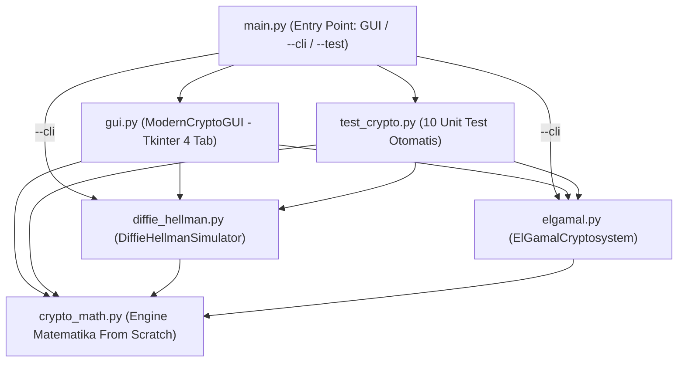

# KriptoLab: Simulator Diffie-Hellman & ElGamal (From Scratch)

Aplikasi Desktop GUI untuk Tugas Besar Kriptografi:
**"Implementasi Algoritma Pertukaran Kunci Diffie-Hellman dan Kriptografi Asimetris ElGamal"**.

Seluruh operasi matematika dan algoritma kriptografi diimplementasikan **100% dari nol (from scratch)** tanpa pustaka kriptografi eksternal — hanya memanfaatkan Python Standard Library (`tkinter`, `math`, `random`, `unittest`, `argparse`).

### 👥 Anggota Kelompok
- **Muhammad Fachry Shalahuddin Rusamsi** — `5027241031`
- **Prabaswara Febrian Winandika** — `5027241069`
- **Gemilang Ananda Lingua** — `5027241072`

**Departemen Teknologi Informasi** — **Institut Teknologi Sepuluh Nopember (ITS)**

---

## 📑 Daftar Isi
1. [Arsitektur & Struktur Proyek](#-arsitektur--struktur-proyek)
2. [Cara Menjalankan Aplikasi](#-cara-menjalankan-aplikasi)
3. [Penjelasan Kode & Rumus: `crypto_math.py`](#-penjelasan-kode--rumus-crypto_mathpy)
4. [Penjelasan Kode & Rumus: `diffie_hellman.py`](#-penjelasan-kode--rumus-diffie_hellmanpy)
5. [Penjelasan Kode & Rumus: `elgamal.py`](#-penjelasan-kode--rumus-elgamalpy)
6. [Antarmuka GUI (`gui.py`), Entry Point (`main.py`), & Pengujian (`test_crypto.py`)](#-antarmuka-gui-guipy-entry-point-mainpy--pengujian-test_cryptopy)

---

## 🏗️ Arsitektur & Struktur Proyek

Proyek dirancang secara modular dengan memisahkan *math engine*, logika protokol kriptografi, antarmuka pengguna (GUI/CLI), dan pengujian otomatis:



| File | Peran & Tanggung Jawab |
| :--- | :--- |
| `crypto_math.py` | Implementasi fungsi matematika dasar kriptografi dari nol (`mod_pow`, `gcd`, `ext_gcd`, `mod_inverse`, `mod_inverse_fermat`, `is_prime`, `get_prime_factors`, `is_primitive_root`, `find_primitive_roots`, `generate_prime`). |
| `diffie_hellman.py` | Kelas `DiffieHellmanSimulator` untuk validasi parameter, perhitungan kunci publik & kunci sesi bersama, pembangkitan parameter acak valid, dan log eksekusi. |
| `elgamal.py` | Kelas `ElGamalCryptosystem` untuk keygen, konversi teks ke blok numerik (2-karakter & 1-karakter), enkripsi, dekripsi dengan verifikasi ganda, dan log eksekusi. |
| `gui.py` | Kelas `ModernCryptoGUI` berbasis `tkinter`/`ttk` dengan tema dark mode, 4 tab modul, serta ekspor log ke clipboard atau file `.txt`. |
| `main.py` | Entry point aplikasi dengan argumen `--test` dan `--cli` (default membuka GUI). |
| `test_crypto.py` | Suite 10 unit test otomatis menggunakan `unittest`. |
| `LAPORAN_PROGRAM.md` | Draf laporan akademik program. |

---

## 💻 Cara Menjalankan Aplikasi

**Persyaratan:** Python 3.10 atau lebih baru (tidak memerlukan instalasi paket `pip` tambahan).

```bash
# 1. Menjalankan Aplikasi Desktop GUI (Default)
python main.py

# 2. Menjalankan 10 Unit Test Otomatis
python main.py --test

# 3. Menjalankan Demonstrasi Terminal (CLI)
python main.py --cli
```

---

## 📐 Penjelasan Kode & Rumus: `crypto_math.py`

File ini menyediakan seluruh primitif teori bilangan yang dipakai oleh Diffie-Hellman dan ElGamal.

### 1. Pemangkatan Modular — Algoritma Square-and-Multiply (`mod_pow` & `mod_pow_trace`)

#### Dasar Matematis
Untuk menghitung $a^e \bmod m$ tanpa menghasilkan bilangan antara (*intermediate integer*) berukuran raksasa, eksponen $e$ diuraikan ke dalam representasi biner:

$$e = \sum_{i=0}^{k} b_i \cdot 2^i \quad \text{dengan } b_i \in \{0, 1\}$$

Sehingga:

$$a^e \bmod m = \left( \prod_{b_i = 1} a^{2^i} \right) \bmod m$$

Jika eksponen bernilai negatif ($e < 0$), berlaku sifat balikan modular:

$$a^{-e} \equiv \left(a^{-1}\right)^{e} \pmod m$$

#### Implementasi Kode (`crypto_math.py` baris 32–54)
```python
if mod <= 0:
    raise ValueError("Modulus harus berupa bilangan bulat positif (> 0).")
if mod == 1:
    return 0
if exp < 0:
    inv_base = mod_inverse(base % mod, mod)
    return mod_pow(inv_base, -exp, mod)

result = 1
base = base % mod
current_exp = exp

while current_exp > 0:
    if current_exp & 1:                # Jika bit b_i == 1 (Multiply)
        result = (result * base) % mod
    base = (base * base) % mod         # Kuadratkan basis: a^(2^i) -> a^(2^(i+1)) (Square)
    current_exp >>= 1                  # Geser bit ke kanan (current_exp // 2)

return result
```

#### Pemetaan Kode terhadap Rumus
- `current_exp & 1`: Mengecek bit paling kanan ($b_i$) dari representasi biner eksponen.
- `result = (result * base) % mod`: Langkah **Multiply** — mengalikan `result` dengan $a^{2^i} \bmod m$ hanya jika bit $b_i = 1$.
- `base = (base * base) % mod`: Langkah **Square** — menyiapkan pangkat kuadrat berikutnya $a^{2^{i+1}} \bmod m$ sambil menjaga nilai tetap $< m$.
- `current_exp >>= 1`: Membagi eksponen dengan 2 di setiap iterasi, sehingga kompleksitas waktu menjadi **$O(\log e)$** dan kompleksitas ruang **$O(1)$**.
- Fungsi `mod_pow_trace(base, exp, mod)` (baris 57–100) menjalankan algoritma yang sama sambil merekam setiap langkah bit, aksi *multiply*, dan aksi *square* ke dalam daftar `steps`.

---

### 2. Algoritma Euclidean & Extended Euclidean (`gcd` & `ext_gcd`)

#### Dasar Matematis
- **Algoritma Euclidean** mencari Faktor Persekutuan Terbesar (FPB) berdasarkan relasi rekurensi:
  $$\gcd(a, b) = \gcd(b, a \bmod b), \quad \text{berhenti saat } b = 0 \implies \gcd(a, 0) = a$$
- **Extended Euclidean Algorithm** mencari $g = \gcd(a, b)$ sekaligus **koefisien Bézout** $(x, y)$ yang memenuhi:
  $$a \cdot x + b \cdot y = \gcd(a, b)$$
  Pada setiap langkah pembagian bulat $q = \lfloor a / b \rfloor$, koefisien diperbarui secara iteratif:
  $$(x_0, x_1) \leftarrow (x_1, \; x_0 - q \cdot x_1), \qquad (y_0, y_1) \leftarrow (y_1, \; y_0 - q \cdot y_1)$$

#### Implementasi Kode (`crypto_math.py` baris 103–136)
```python
def gcd(a: int, b: int) -> int:
    a, b = abs(a), abs(b)
    while b != 0:
        a, b = b, a % b
    return a

def ext_gcd(a: int, b: int) -> tuple[int, int, int]:
    x0, x1 = 1, 0
    y0, y1 = 0, 1
    while b != 0:
        q = a // b
        a, b = b, a % b
        x0, x1 = x1, x0 - q * x1
        y0, y1 = y1, y0 - q * y1
    return a, x0, y0
```

#### Pemetaan Kode terhadap Rumus
- Nilai awal $(x_0, y_0) = (1, 0)$ merepresentasikan $a = 1 \cdot a + 0 \cdot b$, dan $(x_1, y_1) = (0, 1)$ merepresentasikan $b = 0 \cdot a + 1 \cdot b$.
- Saat loop berakhir (`b == 0`), variabel `a` menyimpan $\gcd(a_{\text{awal}}, b_{\text{awal}})$, sedangkan `x0` dan `y0` menyimpan koefisien Bézout $x$ dan $y$. Kompleksitas waktu: $O(\log(\min(a, b)))$.

---

### 3. Balikan Modular (`mod_inverse` & `mod_inverse_fermat`)

#### Dasar Matematis
Bilangan $a^{-1} \bmod m$ adalah bilangan bulat yang memenuhi:

$$a \cdot a^{-1} \equiv 1 \pmod m$$

Terdapat dua metode yang diimplementasikan:
1. **Via Extended Euclidean (`mod_inverse`):** Dari $a \cdot x + m \cdot y = \gcd(a, m)$, jika $\gcd(a, m) = 1$, maka diambil modulo $m$ menghasilkan $a \cdot x \equiv 1 \pmod m$, sehingga $a^{-1} \equiv x \pmod m$. Jika $\gcd(a, m) \neq 1$, balikan modular tidak ada.
2. **Via Teorema Kecil Fermat (`mod_inverse_fermat`):** Jika $p$ prima dan $p \nmid a$, maka:
   $$a^{p-1} \equiv 1 \pmod p \implies a \cdot a^{p-2} \equiv 1 \pmod p \implies a^{-1} \equiv a^{p-2} \pmod p$$

#### Implementasi Kode (`crypto_math.py` baris 139–167)
```python
def mod_inverse(a: int, m: int) -> int:
    a = (a % m + m) % m
    g, x, _ = ext_gcd(a, m)
    if g != 1:
        raise ValueError(
            f"Balikan modular tidak ditemukan karena FPB({a}, {m}) = {g} != 1 (bukan koprima)."
        )
    return (x % m + m) % m

def mod_inverse_fermat(a: int, p: int) -> int:
    if not is_prime(p):
        raise ValueError(f"Modulus p={p} harus merupakan bilangan prima untuk Teorema Fermat.")
    if a % p == 0:
        raise ValueError(f"a={a} tidak boleh merupakan kelipatan prima p={p}.")
    return mod_pow(a, p - 2, p)
```

#### Pemetaan Kode terhadap Rumus
- Ekspresi `(x % m + m) % m` menormalisasi koefisien Bézout $x$ (yang bisa bernilai negatif) ke dalam rentang residu positif $[0, m - 1]$.
- `mod_inverse_fermat` memvalidasi $p$ prima dan $a \not\equiv 0 \pmod p$, lalu langsung menghitung $a^{p-2} \bmod p$ dengan `mod_pow`.

---

### 4. Pengujian Bilangan Prima (`is_prime` & `generate_prime`)

#### Dasar Matematis
- Setiap bilangan bulat $> 3$ dapat ditulis dalam bentuk $6k, 6k+1, 6k+2, 6k+3, 6k+4, 6k+5$.
- Bentuk $6k, 6k+2, 6k+4$ habis dibagi $2$, dan $6k+3$ habis dibagi $3$. Oleh karena itu, **semua bilangan prima $> 3$ pasti berbentuk $6k \pm 1$** (yaitu $6k - 1$ atau $6k + 1$).
- Jika $n$ komposit, pasti terdapat minimal satu faktor prima $\le \sqrt{n}$, sehingga pengujian pembagi cukup sampai $i^2 \le n$.

#### Implementasi Kode (`crypto_math.py` baris 170–190)
```python
def is_prime(n: int) -> bool:
    if n <= 1:
        return False
    if n <= 3:
        return True
    if n % 2 == 0 or n % 3 == 0:
        return False

    i = 5
    while i * i <= n:
        if n % i == 0 or n % (i + 2) == 0:
            return False
        i += 6
    return True
```

- `i = 5` dan `i + 2 = 7` merepresentasikan $6(1) - 1$ dan $6(1) + 1$, lalu meloncat `i += 6` pada setiap iterasi.
- `generate_prime(min_val, max_val)` (baris 288–301) menyusun kandidat bilangan ganjil di rentang `[min_val, max_val]`, mengacak urutannya (`random.shuffle`), dan mengembalikan bilangan pertama yang lolos `is_prime`.

---

### 5. Faktorisasi Prima & Akar Primitif (`get_prime_factors`, `is_primitive_root`, `find_primitive_roots`)

#### Dasar Matematis
Suatu bilangan bulat $g$ adalah **akar primitif (generator)** dari grup multiplikatif $\mathbb{Z}_p^*$ (untuk $p$ prima) apabila ordo dari $g$ sama dengan $\phi(p) = p - 1$, sehingga $\{g^1, g^2, \dots, g^{p-1}\} \bmod p = \{1, 2, \dots, p-1\}$.

Kriteria pengujian yang efisien tanpa menghitung seluruh $p-1$ pangkat:
1. $p$ adalah bilangan prima, $1 < g < p$, dan $\gcd(g, p) = 1$.
2. Cari semua faktor prima unik $q_1, q_2, \dots, q_r$ dari $\phi(p) = p - 1$.
3. $g$ adalah akar primitif **jika dan hanya jika** untuk setiap faktor prima $q_j$:
   $$g^{(p - 1) / q_j} \not\equiv 1 \pmod p$$

Jika ada satu saja $q_j$ yang menghasilkan $\equiv 1 \pmod p$, maka ordo $g$ membagi $(p-1)/q_j < p-1$, sehingga $g$ bukan generator.

#### Implementasi Kode (`crypto_math.py` baris 237–260)
```python
if not is_prime(p):
    return False, f"Modulus p = {p} bukan bilangan prima!"
if g <= 1 or g >= p:
    return False, f"Nilai g = {g} harus berada pada rentang 1 < g < {p}!"
if gcd(g, p) != 1:
    return False, f"Nilai g = {g} tidak relatif prima dengan p = {p} (FPB != 1)!"

phi = p - 1
factors = get_prime_factors(phi)

for q in factors:
    exp = phi // q
    val = mod_pow(g, exp, p)
    if val == 1:
        return False, ...

return True, ...
```

- `get_prime_factors(n)` (baris 193–219) membagi habis faktor $2$, lalu membagi faktor ganjil $d = 3, 5, 7, \dots$ hingga $d^2 \le \text{temp}$, dan mengembalikan himpunan faktor prima unik terurut.
- `find_primitive_roots(p, max_count=10)` (baris 263–285) menguji kandidat $g = 2, 3, \dots, p-1$ terhadap seluruh faktor prima dari $p-1$ untuk menemukan hingga `max_count` generator valid.

---

## 🔑 Penjelasan Kode & Rumus: `diffie_hellman.py`

Protokol Diffie-Hellman diimplementasikan dalam kelas `DiffieHellmanSimulator`. Tujuannya adalah menyepakati kunci sesi simetris bersama ($K_A = K_B$) antara Alice dan Bob melalui saluran publik yang tidak aman.

### 1. Validasi Parameter (`validate`, baris 46–69)
Memastikan syarat matematis protokol terpenuhi sebelum komputasi:
- $p$ prima $\rightarrow$ `is_prime(self.p)`
- $g$ akar primitif modulo $p$ $\rightarrow$ `is_primitive_root(self.g, self.p)`
- Kunci privat Alice $1 \le x < p$ dan Bob $1 \le y < p$ $\rightarrow$ `1 <= self.x < self.p` dan `1 <= self.y < self.p`

### 2. Kalkulasi Kunci Publik & Kunci Sesi Bersama (`execute`, baris 71–108)

#### Rumus Protokol
| Tahap | Pihak | Rumus Matematis | Baris Kode di `execute()` |
| :--- | :--- | :--- | :--- |
| 1. Kunci Publik | Alice | $X = g^x \bmod p$ | `self.X = mod_pow(self.g, self.x, self.p)` |
| 2. Kunci Publik | Bob | $Y = g^y \bmod p$ | `self.Y = mod_pow(self.g, self.y, self.p)` |
| 3. Kunci Sesi | Alice | $K_A = Y^x \bmod p$ | `self.Ka = mod_pow(self.Y, self.x, self.p)` |
| 4. Kunci Sesi | Bob | $K_B = X^y \bmod p$ | `self.Kb = mod_pow(self.X, self.y, self.p)` |
| 5. Verifikasi | Sistem | $K_A = K_B$ | `is_match = (self.Ka == self.Kb)` |

#### Pembuktian Kesetaraan Kunci Sesi
$$K_A = Y^x \bmod p = (g^y)^x \bmod p = g^{y \cdot x} \bmod p$$
$$K_B = X^y \bmod p = (g^x)^y \bmod p = g^{x \cdot y} \bmod p$$

Karena perkalian bilangan bulat bersifat komutatif ($x \cdot y = y \cdot x$), maka $K_A = K_B$.

#### Landasan Keamanan (Discrete Logarithm Problem)
Penyerang (Eve) pada saluran publik hanya melihat $[p, g, X, Y]$. Untuk memperoleh kunci sesi $K$, Eve harus mencari $x = \log_g(X) \bmod p$ atau $y = \log_g(Y) \bmod p$, yang tergolong *intractable* (sulit secara komputasi) untuk prima $p$ berukuran besar.

### 3. Verifikasi Perhitungan Preset (`PRESET_VIDEO`)
Parameter: $p = 251$, $g = 6$, $x = 124$, $y = 158$.
- Faktor prima dari $\phi(251) = 250 = 2 \times 5^3$ adalah $[2, 5]$.
  - $6^{250/2} \bmod 251 = 6^{125} \bmod 251 = 250 \neq 1$
  - $6^{250/5} \bmod 251 = 6^{50} \bmod 251 = 219 \neq 1$
  - Maka $g = 6$ valid sebagai akar primitif modulo $251$.
- Kunci Publik Alice: $X = 6^{124} \bmod 251 = \mathbf{209}$
- Kunci Publik Bob: $Y = 6^{158} \bmod 251 = \mathbf{197}$
- Kunci Sesi Alice: $K_A = 197^{124} \bmod 251 = \mathbf{79}$
- Kunci Sesi Bob: $K_B = 209^{158} \bmod 251 = \mathbf{79}$
- Verifikasi: $K_A = K_B = \mathbf{79}$ (`match = True`).

### 4. Pembangkit Parameter Acak & Log (`generate_random_valid` & `generate_detailed_log`)
- `generate_random_valid()` (baris 187–199) membangkitkan prima $p \in [100, 1000]$ via `generate_prime(100, 1000)`, memilih generator $g$ acak dari `find_primitive_roots(p, max_count=5)`, dan memilih $x, y \in [2, p-2]$.
- `generate_detailed_log()` (baris 110–184) menyusun catatan eksekusi lengkap dari validasi parameter hingga pembuktian matematis dan analisis keamanan DLP.

---

## 🛡️ Penjelasan Kode & Rumus: `elgamal.py`

Kriptosistem asimetris ElGamal diimplementasikan dalam kelas `ElGamalCryptosystem` melalui empat tahap: **Key Generation**, **Message Encoding**, **Enkripsi**, dan **Dekripsi**.

### 1. Pembangkitan Kunci — Key Generation Alice (`validate_keys` & `compute_public_key`)

#### Rumus
1. Pilih bilangan prima $p$ dan akar primitif $g$ modulo $p$.
2. Pilih kunci privat $x$ dengan syarat $1 < x < p - 1$.
3. Hitung komponen kunci publik $y$:
   $$y = g^x \bmod p$$
4. **Kunci Publik:** $(y, g, p)$ | **Kunci Privat:** $x$.

#### Implementasi Kode (`elgamal.py` baris 63–88)
```python
def validate_keys(self) -> tuple[bool, list[str]]:
    errors = []
    if not is_prime(self.p):
        errors.append(f"p = {self.p} bukan bilangan prima!")
    is_root, _ = is_primitive_root(self.g, self.p)
    if not is_root:
        errors.append(f"g = {self.g} bukan akar primitif modulo {self.p}!")
    if not (1 < self.x < self.p - 1):
        errors.append(f"Kunci privat x = {self.x} harus memenuhi 1 < x < {self.p - 1}!")
    return len(errors) == 0, errors

def compute_public_key(self) -> int:
    is_ok, errs = self.validate_keys()
    if not is_ok:
        raise ValueError("Kunci tidak valid: " + "; ".join(errs))
    self.y = mod_pow(self.g, self.x, self.p)
    return self.y
```

---

### 2. Konversi Teks ke Blok Numerik (`text_to_blocks_2char` & `blocks_to_text_2char`)

#### Aturan Pemetaan & Syarat Blok
- Setiap karakter alfabet dipetakan menjadi 2 digit: $A = 00, B = 01, \dots, Z = 25$ menggunakan `ord(ch) - ord("A")`.
- Pada **mode `2char`** (2 karakter per blok):
  - Jika panjang teks bersih ganjil, ditambahkan karakter padding `'X'` di akhir.
  - Dua karakter $(c_1, c_2)$ digabung menjadi bilangan bulat 4 digit: $m_i = 100 \cdot c_1 + c_2$ (rentang $0000$ hingga $2525$).
  - **Syarat wajib aritmetika modulo:** setiap blok harus memenuhi **$m_i < p$**. Jika $m_i \ge p$, operasi $\bmod p$ saat dekripsi akan mereduksi nilai asli sehingga pesan tidak dapat dipulihkan secara utuh.
- Tersedia juga **mode `1char`** (`text_to_blocks_1char` / `blocks_to_text_1char`, baris 163–196) dengan rentang $0 \dots 25$ untuk prima kecil ($p > 25$).

#### Implementasi Kode (`elgamal.py` baris 109–160)
```python
# Encoding 2 karakter per blok
clean = "".join([c.upper() for c in text if c.isalpha()])
padded_text = clean + pad_char if len(clean) % 2 != 0 else clean

for i in range(0, len(padded_text), 2):
    chunk = padded_text[i : i + 2]
    c1 = ord(chunk[0]) - ord("A")
    c2 = ord(chunk[1]) - ord("A")
    num_str = f"{c1:02d}{c2:02d}"
    val = int(num_str)
    if val >= p:
        raise ValueError(f"Blok '{chunk}' bernilai {val} >= p ({p})! ...")

# Decoding kembali ke teks
for val in m_list:
    s = f"{val:04d}"
    c1, c2 = int(s[:2]), int(s[2:])
    chars.append(chr(ord("A") + c1))
    chars.append(chr(ord("A") + c2))
```

---

### 3. Pemilihan Ephemeral Key `k` & Enkripsi Bob (`pick_random_k` & `encrypt`)

#### Rumus Enkripsi
Untuk setiap blok pesan $m_i$:
1. Pilih bilangan acak (*ephemeral key*) $k_i \in [2, p - 2]$ yang koprima dengan $p - 1$ ($\gcd(k_i, p - 1) = 1$).
2. Hitung pasangan ciphertext $(a_i, b_i)$ menggunakan kunci publik Alice $(y, g, p)$:
   $$a_i = g^{k_i} \bmod p$$
   $$b_i = \left(y^{k_i} \cdot m_i\right) \bmod p$$

Karena $k_i$ dipilih acak di setiap enkripsi, ElGamal bersifat **probabilistik (nondeterministik)**: plainteks yang sama akan menghasilkan pasangan ciphertext $(a_i, b_i)$ yang berbeda jika $k_i$ berbeda.

#### Implementasi Kode (`elgamal.py` baris 202–269)
```python
def pick_random_k(self) -> int:
    phi = self.p - 1
    for _ in range(10000):
        k = random.randint(2, phi - 1)
        if gcd(k, phi) == 1:
            return k
    ...

# Di dalam encrypt():
a_i = mod_pow(self.g, k_i, self.p)       # a_i = g^(k_i) mod p
y_pow_k = mod_pow(self.y, k_i, self.p)   # y^(k_i) mod p
b_i = (y_pow_k * m_i) % self.p           # b_i = (y^(k_i) * m_i) mod p
cipher_pairs.append((a_i, b_i))
```

---

### 4. Dekripsi Alice dengan Verifikasi Ganda (`decrypt`)

#### Rumus & Pembuktian Matematis
Untuk memulihkan $m_i$ dari pasangan $(a_i, b_i)$ menggunakan kunci privat $x$, Alice menghitung:

$$m_i = \left(b_i \cdot (a_i^x)^{-1}\right) \bmod p$$

Berdasarkan **Teorema Kecil Fermat**, karena $a_i^{p-1} \equiv 1 \pmod p$, maka balikan modular dari $a_i^x$ adalah:

$$(a_i^x)^{-1} \equiv a_i^{-x} \equiv a_i^{p - 1 - x} \pmod p$$

Substitusi $a_i \equiv g^k \pmod p$ dan $b_i \equiv y^k \cdot m_i \equiv g^{xk} \cdot m_i \pmod p$ membuktikan pemulihan pesan:

$$b_i \cdot a_i^{p - 1 - x} \equiv \left(g^{xk} \cdot m_i\right) \cdot \left(g^k\right)^{p - 1 - x} \equiv m_i \cdot g^{xk + k(p-1) - xk} \equiv m_i \cdot \left(g^{p-1}\right)^k \equiv m_i \cdot 1^k \equiv m_i \pmod p$$

#### Implementasi Kode (`elgamal.py` baris 310–333)
Di dalam fungsi `decrypt()`, kedua cara penghitungan balikan modular dijalankan sekaligus untuk verifikasi konsistensi internal:

```python
for idx, (a_i, b_i) in enumerate(cipher_pairs):
    # Cara 1: Teorema Kecil Fermat -> (a_i^x)^(-1) ≡ a_i^(p - 1 - x) mod p
    fermat_exp = self.p - 1 - self.x
    inv_ax_fermat = mod_pow(a_i, fermat_exp, self.p)
    m_fermat = (b_i * inv_ax_fermat) % self.p

    # Cara 2: Extended Euclidean Algorithm -> mod_inverse(a_i^x mod p, p)
    ax = mod_pow(a_i, self.x, self.p)
    inv_ax_euclid = mod_inverse(ax, self.p)
    m_euclid = (b_i * inv_ax_euclid) % self.p

    decrypted_m.append(m_fermat)
    # check_match memverifikasi m_fermat == m_euclid
```

- **Cara 1 (Fermat)** hanya memerlukan 1 kali `mod_pow(a_i, p - 1 - x, p)`.
- **Cara 2 (Extended Euclidean)** menghitung $a_i^x \bmod p$ terlebih dahulu lalu mencari balikannya melalui `mod_inverse(ax, p)`.
- Flag `check_match = (m_fermat == m_euclid)` memastikan kedua metode selalu menghasilkan nilai $m_i$ yang identik.

---

### 5. Verifikasi Perhitungan Preset (`PRESET_VIDEO`)
Parameter: $p = 2273$, $g = 3$, $x = 243$, Plainteks $M = \text{"HALO"}$, $k = 1463$.

1. **Key Generation Alice:**
   $$y = 3^{243} \bmod 2273 = \mathbf{461}$$
   Kunci Publik: $(461, 3, 2273)$, Kunci Privat: $x = 243$.
2. **Encoding Blok (2-karakter):**
   - Blok #1: `'HA'` $\rightarrow$ `H=07`, `A=00` $\rightarrow$ `"0700"` $\rightarrow$ $m_1 = \mathbf{700} < 2273$
   - Blok #2: `'LO'` $\rightarrow$ `L=11`, `O=14` $\rightarrow$ `"1114"` $\rightarrow$ $m_2 = \mathbf{1114} < 2273$
3. **Enkripsi Bob ($k = 1463$):**
   - $a_1 = a_2 = 3^{1463} \bmod 2273 = \mathbf{1439}$
   - $y^k \bmod p = 461^{1463} \bmod 2273 = 1825$
   - $b_1 = (1825 \cdot 700) \bmod 2273 = \mathbf{74} \implies c_1 = \mathbf{(1439, 74)}$
   - $b_2 = (1825 \cdot 1114) \bmod 2273 = \mathbf{988} \implies c_2 = \mathbf{(1439, 988)}$
4. **Dekripsi Alice ($p - 1 - x = 2273 - 1 - 243 = 2029$):**
   - $(a_i^x)^{-1} \bmod 2273 = 1439^{2029} \bmod 2273 = 1791$
   - $m_1 = (74 \cdot 1791) \bmod 2273 = \mathbf{700} \rightarrow \text{"0700"} \rightarrow \text{'HA'}$
   - $m_2 = (988 \cdot 1791) \bmod 2273 = \mathbf{1114} \rightarrow \text{"1114"} \rightarrow \text{'LO'}$
   - Hasil rekonstruksi: **`HALO`** (cocok 100%).

---

## 🖥️ Antarmuka GUI (`gui.py`), Entry Point (`main.py`), & Pengujian (`test_crypto.py`)

### 1. Antarmuka Desktop (`gui.py`)
Kelas `ModernCryptoGUI(tk.Tk)` mengintegrasikan seluruh modul backend ke dalam antarmuka 4 tab berbasis `ttk.Notebook`:
- **Tab 1 — Modul Diffie-Hellman (`_init_dh_tab`):** Panel input parameter $(p, g, x, y)$, validasi *inline*, tombol preset (`_load_dh_preset`), generator acak valid (`_on_dh_randomize`), ringkasan kunci Alice/Bob + badge kesetaraan $K_A == K_B$, dan panel log step-by-step.
- **Tab 2 — Modul ElGamal (`_init_elgamal_tab`):** Layout 3 kolom yang merepresentasikan alur protokol secara langsung: **A. Key Generation (Alice)** $\rightarrow$ **B. Enkripsi (Bob)** $\rightarrow$ **C. Dekripsi (Alice)**. Hasil enkripsi otomatis diteruskan ke kolom input dekripsi, dan parser di `_on_eg_decrypt` mendukung format pasangan angka `(a1, b1), (a2, b2)`.
- **Tab 3 — Playground Matematika (`_init_math_tab`):** 5 panel uji mandiri untuk menjalankan `mod_pow`, `ext_gcd`, `mod_inverse`, `is_prime`, dan `is_primitive_root` secara langsung.
- **Tab 4 — Panduan Teori & Kelompok (`_init_about_tab`):** Identitas kelompok serta ringkasan konsep teori bilangan dan kriptografi.
- **Panel Log Reusable (`_build_log_panel`):** Dilengkapi tombol **📋 Salin** (ke clipboard) dan **💾 Simpan TXT** (`filedialog.asksaveasfilename`).

### 2. Entry Point (`main.py`)
Menggunakan `argparse` untuk memisahkan 3 mode operasi:
- Default (`python main.py`) menjalankan `run_gui()`, dengan *fallback* otomatis ke `run_cli_demo()` apabila lingkungan tidak mendukung GUI.
- `--cli` menjalankan `run_cli_demo()` untuk mencetak trace Diffie-Hellman dan ElGamal langsung di konsol.
- `--test` menjalankan `run_unit_tests()` yang mengeksekusi seluruh `unittest.TestSuite` dari `test_crypto.py`.

### 3. Pengujian Otomatis (`test_crypto.py`)
Terdiri dari **10 unit test** dalam 3 kelas untuk memverifikasi ketepatan implementasi terhadap referensi matematis dan fungsi bawaan Python:

| Kelas Test | Metode Test | Cakupan Verifikasi |
| :--- | :--- | :--- |
| `TestCryptoMath` | `test_mod_pow` | Kesesuaian `mod_pow(b, e, m)` terhadap built-in `pow(b, e, m)` pada 8 kasus uji (termasuk $e=0$ dan $b=0$). |
| `TestCryptoMath` | `test_mod_pow_trace` | Akurasi hasil dan ketersediaan trace langkah pada `mod_pow_trace(3, 13, 17)`. |
| `TestCryptoMath` | `test_gcd` | Akurasi `gcd` pada `(48, 18) = 6`, `(101, 103) = 1`, dan `(250, 6) = 2`. |
| `TestCryptoMath` | `test_ext_gcd_and_mod_inverse` | Identitas Bézout $35x + 15y = 5$ serta kesetaraan `mod_inverse(3, 11) == mod_inverse_fermat(3, 11) == 4`. |
| `TestCryptoMath` | `test_is_prime` | Klasifikasi 10 bilangan prima (hingga `7919`) dan 10 bilangan non-prima/komposit (`0, 1, 4, ..., 2274`). |
| `TestCryptoMath` | `test_primitive_root` | Verifikasi `6` akar primitif mod `251`, `3` akar primitif mod `2273`, `2` bukan akar primitif mod `7`, dan `3` akar primitif mod `7`. |
| `TestDiffieHellman` | `test_preset_video` | Verifikasi preset: $p=251, g=6, x=124, y=158 \implies X=209, Y=197, K_A=K_B=79$. |
| `TestDiffieHellman` | `test_random_simulation` | Verifikasi parameter acak dari `generate_random_valid()` selalu menghasilkan $K_A == K_B$. |
| `TestElGamal` | `test_preset_video` | Verifikasi preset: $y=461$, blok `[700, 1114]`, ciphertext `[(1439, 74), (1439, 988)]`, dekripsi kembali ke `'HALO'`. |
| `TestElGamal` | `test_random_encryption` | Verifikasi enkripsi-dekripsi dengan $k$ acak dan padding otomatis pada `'KRIPTOGRAFI'` $\rightarrow$ `'KRIPTOGRAFIX'`. |
