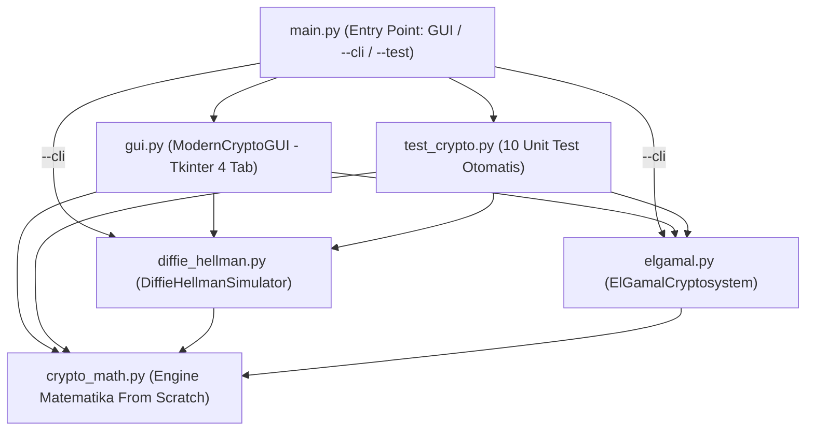

# KriptoLab: Simulator Diffie-Hellman & ElGamal (From Scratch)

Aplikasi Desktop GUI modern untuk Tugas Besar Kriptografi:
**"Implementasi Algoritma Pertukaran Kunci Diffie-Hellman dan Kriptografi Asimetris ElGamal"**.

Seluruh algoritma matematika dan kriptografi diimplementasikan **100% DARI NOL (FROM SCRATCH)** tanpa pustaka kriptografi eksternal — hanya menggunakan Python Standard Library (`tkinter`, `math`, `random`, `unittest`, `argparse`).

### 👥 Anggota Kelompok
- **Muhammad Fachry Shalahuddin Rusamsi** — `5027241031`
- **Prabaswara Febrian Winandika** — `5027241069`
- **Gemilang Ananda Lingua** — `5027241072`

**Departemen Teknologi Informasi** — **Institut Teknologi Sepuluh Nopember (ITS)**

---

## 📑 Daftar Isi
1. [Arsitektur & Struktur Proyek](#-arsitektur--struktur-proyek)
2. [Cara Menjalankan](#-cara-menjalankan)
3. [Naskah Alur Demo Presentasi (Tinggal Baca)](#-naskah-alur-demo-presentasi-tinggal-baca)
4. [Penjelasan Detail Kode Per File](#-penjelasan-detail-kode-per-file)
   - [1. `crypto_math.py` — Engine Matematika Murni](#1-crypto_mathpy--engine-matematika-murni)
   - [2. `diffie_hellman.py` — Pertukaran Kunci Diffie-Hellman](#2-diffie_hellmanpy--pertukaran-kunci-diffie-hellman)
   - [3. `elgamal.py` — Kriptosistem Asimetris ElGamal](#3-elgamalpy--kriptosistem-asimetris-elgamal)
   - [4. `gui.py` — Antarmuka Desktop Tkinter](#4-guipy--antarmuka-desktop-tkinter)
   - [5. `main.py` — Entry Point Aplikasi](#5-mainpy--entry-point-aplikasi)
   - [6. `test_crypto.py` — Unit Testing Otomatis](#6-test_cryptopy--unit-testing-otomatis)
5. [Contekan Tanya-Jawab (FAQ Presentasi)](#-contekan-tanya-jawab-faq-presentasi)

---

## 🏗️ Arsitektur & Struktur Proyek

Proyek ini dirancang secara **modular** dengan pemisahan yang jelas antara *math engine*, *logika kriptografi*, *antarmuka pengguna (GUI/CLI)*, dan *pengujian otomatis*:



| File | Fungsi & Tanggung Jawab |
| :--- | :--- |
| `crypto_math.py` | Pustaka matematika kriptografi buatan sendiri (`mod_pow`, `gcd`, `ext_gcd`, `mod_inverse`, `is_prime`, `is_primitive_root`, `generate_prime`). |
| `diffie_hellman.py` | Implementasi protokol Diffie-Hellman (validasi parameter, hitung kunci publik $X, Y$, hitung kunci sesi $K_A, K_B$, log detail, generator acak). |
| `elgamal.py` | Implementasi ElGamal (Keygen, konversi blok 2-karakter & 1-karakter, pemilihan $k$ acak, enkripsi, dekripsi dengan verifikasi ganda, log detail). |
| `gui.py` | Aplikasi desktop dark-mode berbasis `tkinter`/`ttk` dengan 4 tab interaktif serta fitur salin & simpan log ke `.txt`. |
| `main.py` | Pintu masuk utama program dengan dukungan 3 mode: GUI (default), `--cli`, dan `--test`. |
| `test_crypto.py` | 10 unit test otomatis menggunakan `unittest` untuk memverifikasi akurasi matematis terhadap `pow()` bawaan Python & soal preset. |
| `LAPORAN_PROGRAM.md` | Draf laporan resmi akademik proyek. |

---

## 💻 Cara Menjalankan

**Persyaratan:** Python 3.10+ (tidak perlu `pip install` apa pun).

```bash
# 1. Menjalankan Aplikasi Desktop GUI (Default)
python main.py

# 2. Menjalankan 10 Unit Test Otomatis (Verifikasi Akurasi)
python main.py --test

# 3. Menjalankan Demo Cepat via Terminal (CLI)
python main.py --cli
```

---

## 🎤 Naskah Alur Demo Presentasi (Tinggal Baca)

Gunakan urutan ini saat demo langsung agar alur presentasi rapi, terstruktur, dan meyakinkan (estimasi 5–7 menit):

### Langkah 1 — Pembukaan & Klaim *From Scratch*
> *"Aplikasi ini bernama **KriptoLab**, dibangun 100% dari nol menggunakan Python murni tanpa library kriptografi eksternal seperti PyCryptodome atau Cryptography. Bahkan pemangkatan modular, uji prima, pencarian akar primitif, sampai invers modular semuanya kami tulis sendiri di `crypto_math.py`."*

### Langkah 2 — Bukti Keakuratan Lewat Unit Test
Jalankan di terminal:
```bash
python main.py --test
```
> *"Sebelum masuk ke GUI, ini adalah 10 unit test otomatis di `test_crypto.py` yang menguji fungsi matematika buatan kami dibandingkan hasil `pow()` bawaan Python serta memverifikasi soal contoh Diffie-Hellman dan ElGamal. Semuanya lulus (`OK`)."*

### Langkah 3 — Demo GUI Tab 1: Diffie-Hellman Key Exchange
Jalankan `python main.py`, buka tab **🔑 Modul 1: Diffie-Hellman**:
1. Tunjukkan preset awal yang langsung ter-load: **`p = 251`, `g = 6`, `x = 124`, `y = 158`**.
2. Jelaskan hasil di panel kanan:
   - Kunci Publik Alice: $X = 6^{124} \bmod 251 = \mathbf{209}$
   - Kunci Publik Bob: $Y = 6^{158} \bmod 251 = \mathbf{197}$
   - Kunci Sesi Alice: $K_A = 197^{124} \bmod 251 = \mathbf{79}$
   - Kunci Sesi Bob: $K_B = 209^{158} \bmod 251 = \mathbf{79}$
   - Status hijau: **$K_A == K_B = 79$ (Match!)**
3. Tunjukkan **Log Step-by-Step** di bagian bawah (menampilkan faktorisasi $p-1$, parameter yang terlihat oleh Eve, pembuktian matematis, dan analisis DLP).
4. Uji fitur **validasi**: ubah `p` menjadi angka bukan prima (misal `250`) atau `g` bukan akar primitif, klik **🚀 Jalankan Simulasi** → aplikasi otomatis menolak dengan pesan error yang jelas.
5. Klik **🎲 Acak Valid** → sistem membangkitkan prima baru, mencari akar primitif valid secara otomatis, dan tetap menghasilkan $K_A == K_B$.

### Langkah 4 — Demo GUI Tab 2: Kriptografi Asimetris ElGamal
Pindah ke tab **🛡️ Modul 2: Kriptografi ElGamal** (terdiri dari 3 kolom: **A. Keygen Alice → B. Enkripsi Bob → C. Dekripsi Alice**):
1. Tunjukkan **Preset HALO** (`p = 2273`, `g = 3`, `x = 243`, Plainteks = `HALO`, `k = 1463`):
   - **Keygen Alice:** Kunci publik $y = 3^{243} \bmod 2273 = \mathbf{461}$.
   - **Encoding Blok (2 karakter, A=00..Z=25):**
     - `'HA'` $\rightarrow$ H=`07`, A=`00` $\rightarrow$ $m_1 = \mathbf{700}$ ($< 2273$)
     - `'LO'` $\rightarrow$ L=`11`, O=`14` $\rightarrow$ $m_2 = \mathbf{1114}$ ($< 2273$)
   - **Enkripsi Bob:** menghasilkan ciphertext **`(1439, 74), (1439, 988)`**.
   - **Dekripsi Alice:** memulihkan blok `[700, 1114]` $\rightarrow$ teks **`HALO`** (Cocok 100%).
2. **Tunjukkan sifat Nondeterministik ElGamal (nilai plus!):**
   - Kosongkan kolom **Nilai k Acak**, lalu klik **🔒 Enkripsi Pesan** dua kali berturut-turut dengan plainteks yang sama (`HALO`).
   - Tunjukkan bahwa **ciphertext-nya berubah setiap kali dienkripsi** karena $k$ dipilih acak baru, tetapi saat diklik **🔓 Dekripsi Pesan** hasilnya tetap kembali ke **`HALO`**.
3. **Uji Padding & Plainteks Custom:**
   - Masukkan kata dengan panjang ganjil (misal `KRIPTOGRAFI`, 11 huruf) → sistem otomatis menambahkan padding `'X'` menjadi `KRIPTOGRAFIX` (6 blok) agar genap 2 karakter per blok.

### Langkah 5 — Demo GUI Tab 3 & Tab 4
- Buka **📐 Playground Matematika (Scratch)**: tunjukkan bahwa 5 fungsi dasar (`mod_pow`, `gcd/ext_gcd`, `mod_inverse`, `is_prime`, `is_primitive_root`) bisa diuji secara langsung dan transparan (misal uji `g = 3, p = 2273` menampilkan pembuktian semua faktor prima dari $p-1$).
- Buka **📖 Panduan Teori & Kelompok**: tunjukkan identitas kelompok & rangkuman teori.

---

## 🔍 Penjelasan Detail Kode Per File

Bagian ini bisa langsung dibaca jika dosen meminta **"Coba buka kodenya dan jelaskan cara kerjanya!"**.

---

### 1. `crypto_math.py` — Engine Matematika Murni

File ini adalah fondasi utama yang menggantikan seluruh kebutuhan library kriptografi eksternal.

#### a. `mod_pow(base, exp, mod)` & `mod_pow_trace(base, exp, mod)`
- **Tujuan:** Menghitung $\text{base}^{\text{exp}} \bmod \text{mod}$ tanpa menyebabkan angka raksasa (*overflow* / lambat).
- **Algoritma:** **Square-and-Multiply (Binary Exponentiation)** dengan kompleksitas waktu $O(\log e)$ dan ruang $O(1)$.
- **Cara kerja di kode (baris 41–54):**
  ```python
  result = 1
  base = base % mod
  current_exp = exp
  while current_exp > 0:
      if current_exp & 1:                # Cek bit paling kanan (LSB) apakah 1
          result = (result * base) % mod # Multiply step
      base = (base * base) % mod         # Square step
      current_exp >>= 1                  # Geser bit ke kanan (bagi 2)
  ```
- **Penanganan khusus:** Jika `exp < 0`, fungsi otomatis menghitung invers modularnya terlebih dahulu lalu memangkatkan dengan `-exp`: $(a^{-1})^{-e} \bmod m$.
- `mod_pow_trace` adalah versi edukasi yang mencatat setiap iterasi bit (aksi *multiply* dan *square*) ke dalam list untuk keperluan trace.

#### b. `gcd(a, b)` & `ext_gcd(a, b)`
- **`gcd(a, b)` (baris 103–113):** Algoritma Euclidean standar dengan pengulangan `a, b = b, a % b` hingga `b == 0`. Kompleksitas $O(\log(\min(a, b)))$.
- **`ext_gcd(a, b)` (baris 116–136):** *Extended Euclidean Algorithm* versi iteratif. Selain mengembalikan $g = \gcd(a, b)$, fungsi ini juga melacak **koefisien Bézout** $(x, y)$ yang memenuhi:
  $$a \cdot x + b \cdot y = \gcd(a, b)$$
  Menggunakan pembagian bulat `q = a // b` dan pembaruan `(x0, x1) = (x1, x0 - q * x1)` serta `(y0, y1) = (y1, y0 - q * y1)`.

#### c. `mod_inverse(a, m)` & `mod_inverse_fermat(a, p)`
- **`mod_inverse(a, m)` (baris 139–152):** Memanggil `ext_gcd(a, m)`. Jika $g \neq 1$, melempar `ValueError` karena $a$ dan $m$ tidak koprima (balikan modular tidak ada). Jika $g = 1$, mengembalikan `(x % m + m) % m` agar hasilnya selalu positif pada rentang $[0, m-1]$.
- **`mod_inverse_fermat(a, p)` (baris 155–167):** Menggunakan **Teorema Kecil Fermat** untuk modulus prima $p$:
  $$a^{p-1} \equiv 1 \pmod p \implies a^{-1} \equiv a^{p-2} \pmod p$$
  Dihitung langsung lewat `mod_pow(a, p - 2, p)`.

#### d. `is_prime(n)` & `generate_prime(min_val, max_val)`
- **`is_prime(n)` (baris 170–190):** Uji bilangan prima deterministik dengan optimasi pola **$6k \pm 1$**:
  - Langsung menolak $n \le 1$, kelipatan 2, dan kelipatan 3 (kecuali 2 dan 3).
  - Menguji pembagi `i = 5, 11, 17, ...` (`i` dan `i + 2`) hanya sampai $i^2 \le n$ ($\sqrt{n}$), sehingga jauh lebih cepat daripada mengecek semua bilangan.
- **`generate_prime` (baris 288–301):** Mengambil kandidat bilangan ganjil di rentang `[min_val, max_val]`, mengacak urutannya dengan `random.shuffle`, lalu mengembalikan kandidat pertama yang lolos `is_prime`.

#### e. `get_prime_factors(n)`, `is_primitive_root(g, p)`, & `find_primitive_roots(p)`
- **`get_prime_factors(n)` (baris 193–219):** Memfaktorisasi $n$ secara manual (bagi habis faktor 2, lalu pembagi ganjil $3, 5, 7, \dots$ hingga $\sqrt{n}$) dan mengembalikan faktor prima unik terurut.
- **`is_primitive_root(g, p)` (baris 222–260):** Memverifikasi apakah $g$ adalah generator grup multiplikatif $\mathbb{Z}_p^*$:
  1. Cek $p$ prima, $1 < g < p$, dan $\gcd(g, p) = 1$.
  2. Hitung $\phi(p) = p - 1$ dan cari semua faktor primanya $q \in \text{factors}(p-1)$.
  3. Untuk setiap faktor prima $q$, hitung $g^{(p-1)/q} \bmod p$.
  4. Jika **ada satu saja** yang bernilai `1`, maka ordo $g$ lebih kecil dari $p-1$ → **bukan** akar primitif. Jika semua $\neq 1$ → **VALID sebagai akar primitif**.
- **`find_primitive_roots(p, max_count=10)` (baris 263–285):** Mencari hingga `max_count` akar primitif pertama untuk prima $p$ (dipakai oleh fitur tombol **🎲 Acak Valid**).

---

### 2. `diffie_hellman.py` — Pertukaran Kunci Diffie-Hellman

Berisi kelas `DiffieHellmanSimulator` yang memodelkan pertukaran kunci antara **Alice** dan **Bob**.

#### Alur Method Utama
1. **`PRESET_VIDEO` (baris 27–32):** Menyimpan contoh perkuliahan `p = 251, g = 6, x = 124, y = 158`.
2. **`validate()` (baris 46–69):** Memastikan 4 syarat terpenuhi sebelum menghitung:
   - `is_prime(p)` bernilai `True`.
   - `is_primitive_root(g, p)` bernilai `True`.
   - Kunci privat Alice $1 \le x < p$ dan kunci privat Bob $1 \le y < p$.
3. **`execute()` (baris 71–108):** Menjalankan 4 kalkulasi pemangkatan modular memakai `mod_pow`:
   - Kunci Publik Alice: $X = g^x \bmod p$ (`mod_pow(self.g, self.x, self.p)`)
   - Kunci Publik Bob: $Y = g^y \bmod p$ (`mod_pow(self.g, self.y, self.p)`)
   - Kunci Sesi Alice: $K_A = Y^x \bmod p$ (`mod_pow(self.Y, self.x, self.p)`)
   - Kunci Sesi Bob: $K_B = X^y \bmod p$ (`mod_pow(self.X, self.y, self.p)`)
   - Verifikasi kesetaraan: `is_match = (self.Ka == self.Kb)` karena $(g^y)^x \equiv (g^x)^y \equiv g^{xy} \pmod p$.
4. **`generate_detailed_log()` (baris 110–184):** Menyusun laporan teks 8 bagian (Parameter Publik, Kunci Privat, Kalkulasi Kunci Publik, Pertukaran di Saluran Publik & apa yang dilihat Eve, Kunci Sesi, Verifikasi, Pembuktian Matematis, dan Analisis DLP).
5. **`generate_random_valid()` (baris 187–199):** Classmethod yang membangkitkan prima $p \in [100, 1000]$, memilih salah satu akar primitif $g$ secara acak, lalu membangkitkan kunci privat acak $x, y \in [2, p-2]$.

---

### 3. `elgamal.py` — Kriptosistem Asimetris ElGamal

Berisi kelas `ElGamalCryptosystem` yang mencakup Keygen, Encoding/Decoding blok pesan, Enkripsi, dan Dekripsi.

#### a. Pembangkitan Kunci (`validate_keys` & `compute_public_key`, baris 63–88)
- Validasi: $p$ harus prima, $g$ harus akar primitif mod $p$, dan kunci privat $1 < x < p - 1$.
- Hitung kunci publik Alice:
  $$y = g^x \bmod p$$
- Pasangan kunci yang terbentuk: **Kunci Publik** $(y, g, p)$ dan **Kunci Privat** $x$.

#### b. Pemetaan Teks ke Blok Numerik (`text_to_blocks_*` & `blocks_to_text_*`, baris 94–196)
- **Mode `2char` (default, sesuai slide perkuliahan):**
  - Membersihkan teks menjadi huruf kapital `A–Z` saja.
  - Jika jumlah huruf ganjil, otomatis ditambah huruf padding `'X'`.
  - Memetakan tiap huruf ke 2 digit (`A=00, B=01, ..., Z=25`), lalu menggabungkan 2 huruf menjadi 1 blok integer 4 digit.
    - Contoh: `'HA'` $\rightarrow$ `07` + `00` $\rightarrow$ `"0700"` $\rightarrow$ $m_1 = 700$.
    - Contoh: `'LO'` $\rightarrow$ `11` + `14` $\rightarrow$ `"1114"` $\rightarrow$ $m_2 = 1114$.
  - **Validasi kritis:** Mengecek syarat wajib $m_i < p$. Jika $m_i \ge p$, program melempar `ValueError` agar tidak terjadi kehilangan data akibat operasi modulo $p$.
- **Mode `1char`:** Memetakan 1 huruf per blok (`00–25`), aman untuk prima kecil $p > 25$.
- **Rekonstruksi (`blocks_to_text_2char`):** Memformat ulang integer `m` ke 4 digit `f"{val:04d}"`, memecah 2 digit awal dan 2 digit akhir, lalu mengubahnya kembali ke huruf `chr(ord("A") + c)`.

#### c. Pemilihan Ephemeral Key `k` & Enkripsi (`pick_random_k` & `encrypt`, baris 202–293)
- **`pick_random_k()`:** Memilih $k$ acak pada rentang $[2, p-2]$ yang memenuhi $\gcd(k, p-1) = 1$.
- **`encrypt(text, mode, custom_k_list)`:** Untuk setiap blok $m_i$:
  1. Gunakan $k_i$ dari input user (jika diisi, misal preset `1463`) atau panggil `pick_random_k()` jika kosong.
  2. Hitung pasangan ciphertext $(a_i, b_i)$:
     $$a_i = g^{k_i} \bmod p$$
     $$b_i = (y^{k_i} \cdot m_i) \bmod p$$
  3. Simpan seluruh nilai perantara (`g^k mod p`, `y^k mod p`, `a_i`, `b_i`) ke `block_logs` agar bisa ditampilkan transparan di log.

#### d. Dekripsi dengan Verifikasi Ganda (`decrypt`, baris 295–346)
Untuk setiap pasangan ciphertext $(a_i, b_i)$, kode kami menghitung dekripsi dengan **dua metode sekaligus** untuk membuktikan konsistensi matematisnya:
1. **Cara 1 — Teorema Kecil Fermat (efisien, cukup 1x `mod_pow`):**
   $$(a_i^x)^{-1} \equiv a_i^{p - 1 - x} \pmod p \implies m_i = \left(b_i \cdot a_i^{p - 1 - x}\right) \bmod p$$
2. **Cara 2 — Extended Euclidean Algorithm (pembanding):**
   Hitung `ax = mod_pow(a_i, x, p)`, cari balikannya `inv_ax = mod_inverse(ax, p)`, lalu hitung `m = (b_i * inv_ax) % p`.
- Kedua hasil dibandingkan (`check_match = (m_fermat == m_euclid)`), lalu daftar $m_i$ direkonstruksi kembali menjadi string plainteks.

---

### 4. `gui.py` — Antarmuka Desktop Tkinter

Kelas `ModernCryptoGUI(tk.Tk)` membungkus seluruh logika backend menjadi antarmuka desktop responsif tanpa mengubah rumus kriptografi:
- **Desain & Konfigurasi (`__init__`, `_setup_styles`, baris 37–138):** Tema Dark Slate (`THEME` dictionary), dukungan High-DPI Windows (`SetProcessDpiAwareness(1)`) agar teks tajam di layar modern, serta styling custom `ttk.Notebook`.
- **Tab 1 — Diffie-Hellman (`_init_dh_tab`, baris 248–511):** Menggunakan `PanedWindow` vertikal (atas: input parameter + kartu hasil Alice/Bob & badge sesi; bawah: panel log step-by-step).
- **Tab 2 — ElGamal (`_init_elgamal_tab`, baris 516–937):** Menggunakan layout 3 kolom sejajar (**A. Keygen Alice**, **B. Enkripsi Bob**, **C. Dekripsi Alice**) + panel log per-blok. Hasil enkripsi otomatis disalin ke kolom input dekripsi, dan parser dekripsi mendukung input manual seperti `(1439, 74), (1439, 988)`.
- **Tab 3 — Playground Matematika (`_init_math_tab`, baris 942–1210):** Canvas *scrollable* berisi 5 kartu uji coba langsung untuk `mod_pow`, `ext_gcd`, `mod_inverse`, `is_prime`, dan `is_primitive_root`.
- **Tab 4 — Panduan Teori & Kelompok (`_init_about_tab`, baris 1215–1293):** Menampilkan identitas anggota kelompok dan ringkasan 4 konsep utama (Square-and-Multiply, Primitive Root & DLP, Diffie-Hellman, dan ElGamal).
- **Komponen Reusable (`_build_log_panel`, baris 1336–1413):** Panel log konsol dengan tombol **📋 Salin** (ke clipboard) dan **💾 Simpan TXT** (`filedialog.asksaveasfilename`).

---

### 5. `main.py` — Entry Point Aplikasi

Menggunakan `argparse` agar satu file bisa menjalankan tiga skenario berbeda:
- `python main.py` → memanggil `run_gui()` untuk membuka `ModernCryptoGUI`. Jika lingkungan tidak mendukung tampilan grafis (misal server headless), otomatis *fallback* menjalankan `run_cli_demo()`.
- `python main.py --cli` → memanggil `run_cli_demo()` untuk menampilkan hasil preset Diffie-Hellman dan ElGamal langsung di terminal.
- `python main.py --test` → memanggil `run_unit_tests()` yang memuat 3 suite test dari `test_crypto.py` dengan `verbosity=2`.

---

### 6. `test_crypto.py` — Unit Testing Otomatis

Berisi **10 unit test** dalam 3 kelas pengujian:

| Kelas Test | Metode Test | Apa yang Diverifikasi? |
| :--- | :--- | :--- |
| `TestCryptoMath` | `test_mod_pow` | Membandingkan hasil `mod_pow` buatan sendiri dengan fungsi built-in `pow(b, e, m)` pada 8 kasus uji (termasuk eksponen 0 dan base 0). |
| `TestCryptoMath` | `test_mod_pow_trace` | Memastikan hasil dan jejak langkah `mod_pow_trace(3, 13, 17)` akurat. |
| `TestCryptoMath` | `test_gcd` | Memastikan FPB `(48,18)=6`, `(101,103)=1`, `(250,6)=2`. |
| `TestCryptoMath` | `test_ext_gcd_and_mod_inverse` | Memverifikasi identitas Bézout $35x + 15y = 5$ serta kesamaan hasil `mod_inverse(3, 11)` dan `mod_inverse_fermat(3, 11)` yaitu `4`. |
| `TestCryptoMath` | `test_is_prime` | Menguji 10 bilangan prima (hingga `7919`) dan 10 bilangan komposit/tepi (`0, 1, 4, ...`). |
| `TestCryptoMath` | `test_primitive_root` | Memastikan `6` akar primitif mod `251`, `3` akar primitif mod `2273`, `2` bukan akar primitif mod `7`, dan `3` akar primitif mod `7`. |
| `TestDiffieHellman` | `test_preset_video` | Verifikasi preset: $p=251, g=6, x=124, y=158 \implies X=209, Y=197, K_A=K_B=79$. |
| `TestDiffieHellman` | `test_random_simulation` | Verifikasi parameter acak dari `generate_random_valid()` selalu menghasilkan $K_A == K_B$. |
| `TestElGamal` | `test_preset_video` | Verifikasi preset: $y=461$, blok `[700, 1114]`, ciphertext `[(1439, 74), (1439, 988)]`, dekripsi kembali ke `'HALO'`. |
| `TestElGamal` | `test_random_encryption` | Verifikasi enkripsi-dekripsi dengan $k$ acak dan padding otomatis pada `'KRIPTOGRAFI'` $\rightarrow$ `'KRIPTOGRAFIX'`. |

---

## ❓ Contekan Tanya-Jawab (FAQ Presentasi)

**1. Kenapa pakai algoritma Square-and-Multiply (`mod_pow`), bukan operator pangkat `**` biasa lalu `%`?**
> Jika kita menghitung `(g ** x) % p` secara naif untuk eksponen besar (misal 2048-bit), hasilnya membutuhkan memori raksasa sebelum dimodulo dan kompleksitasnya $O(x)$ (eksponensial terhadap panjang bit). Dengan **Square-and-Multiply**, kita mengkuadratkan dan mengambil modulo di setiap langkah berdasarkan bit biner eksponennya, sehingga kompleksitas turun drastis menjadi **$O(\log x)$** dan ukuran angka intermediate selalu terjaga $< p^2$.

**2. Kenapa parameter $g$ harus berupa akar primitif (primitive root) modulo $p$?**
> Karena akar primitif $g$ membangkitkan seluruh elemen grup multiplikatif $\mathbb{Z}_p^* = \{1, 2, \dots, p-1\}$ saat dipangkatkan ($g^1, g^2, \dots, g^{p-1} \bmod p$ menghasilkan semua sisa yang unik). Jika $g$ bukan akar primitif, ruang kunci yang dihasilkan mengecil (*small subgroup*), sehingga penyerang lebih mudah menebak kunci privat atau memecahkan Discrete Logarithm Problem (DLP).

**3. Bagaimana pembuktian rumus dekripsi ElGamal $m_i = (b_i \cdot a_i^{p-1-x}) \bmod p$?**
> Diketahui $a_i \equiv g^k \pmod p$, $y \equiv g^x \pmod p$, dan $b_i \equiv y^k \cdot m_i \equiv g^{xk} \cdot m_i \pmod p$.
> Saat dekripsi, Alice menghitung:
> $$b_i \cdot a_i^{p - 1 - x} \equiv (g^{xk} \cdot m_i) \cdot (g^k)^{p - 1 - x} \equiv m_i \cdot g^{xk + k(p-1) - xk} \equiv m_i \cdot (g^{p-1})^k \pmod p$$
> Berdasarkan **Teorema Kecil Fermat**, $g^{p-1} \equiv 1 \pmod p$, sehingga hasilnya adalah $m_i \cdot 1^k \equiv m_i \pmod p$.

**4. Kenapa di ElGamal setiap proses enkripsi membutuhkan bilangan acak $k$ (ephemeral key)?**
> Agar ElGamal bersifat **nondeterministik (probabilistik)** — plainteks yang sama akan menghasilkan ciphertext berbeda setiap kali dienkripsi. Jika nilai $k$ yang sama dipakai ulang untuk dua pesan $m_1$ dan $m_2$, maka $a_1 = a_2$ dan rasio $b_1 \cdot b_2^{-1} \equiv m_1 \cdot m_2^{-1} \pmod p$, sehingga penyerang yang mengetahui satu plainteks dapat langsung membongkar plainteks lainnya.

**5. Kenapa pada mode blok ElGamal wajib memenuhi $m_i < p$?**
> Karena seluruh perhitungan ElGamal bekerja pada aritmetika modulo $p$, sehingga hasil dekripsi selalu berada pada rentang $[0, p-1]$. Jika $m_i \ge p$, hasil dekripsi hanya akan mengembalikan $m_i \bmod p$ (informasi asli hilang/rusak). Di kode `elgamal.py`, kami sudah menambahkan pengecekan `if val >= p: raise ValueError(...)` untuk mencegah hal ini.

**6. Apa perbedaan mendasar Diffie-Hellman dan ElGamal?**
> - **Diffie-Hellman** adalah protokol **pertukaran kunci (*key exchange*)** — bukan algoritma enkripsi pesan. Hasil akhirnya adalah satu kunci sesi simetris bersama ($K_A = K_B$) yang selanjutnya bisa dipakai untuk enkripsi simetris (misal AES).
> - **ElGamal** adalah **kriptosistem asimetris penuh** (pembangkitan kunci, enkripsi, dan dekripsi pesan) yang dikembangkan dari ide Diffie-Hellman dan sama-sama bertumpu pada tingkat kesulitan *Discrete Logarithm Problem (DLP)*.

**7. Apa kelemahan Diffie-Hellman dasar dan bagaimana mitigasinya?**
> Diffie-Hellman murni tidak memiliki autentikasi identitas, sehingga rentan terhadap serangan **Man-in-the-Middle (MITM)** — penyerang (Mallory) bisa mencegat kunci publik Alice dan Bob, lalu membangun dua sesi terpisah (Alice–Mallory dan Mallory–Bob). Mitigasinya adalah menggabungkan Diffie-Hellman dengan **Digital Signature** atau **Sertifikat Digital (PKI / TLS)** agar keaslian kunci publik terverifikasi.
